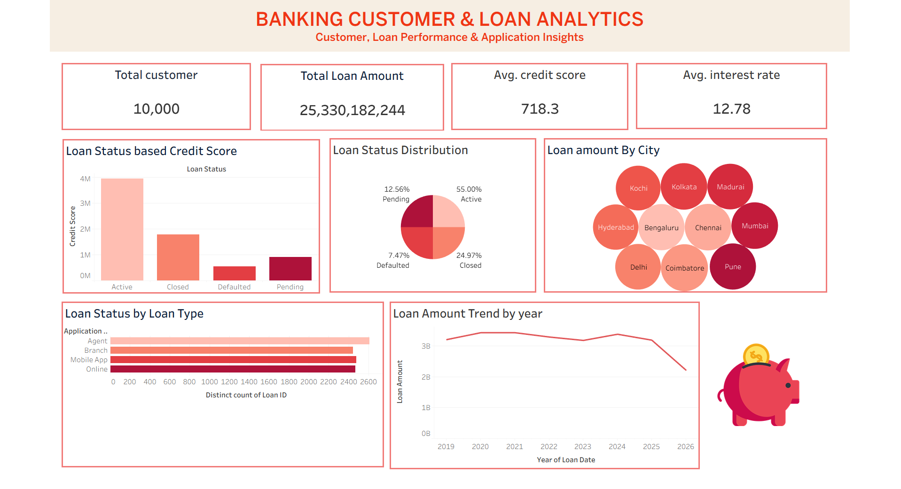

# Banking Customer & Loan Analytics

## Project Overview
This project analyzes banking customer and loan data using Excel for data cleaning and Tableau for interactive dashboard development.

## Tools Used
- Microsoft Excel – Data cleaning and preprocessing
- Tableau – Data visualization and dashboard creation
- GitHub – Project storage and sharing

## Project Files
- `Cleaned_Banking_Data.xlsx` – Cleaned and prepared dataset
- `project.twbx` – Tableau dashboard workbook

## Dashboard Features
- Customer and loan KPIs
- Loan status distribution
- Loan amount by city
- Loan application analysis
- Yearly loan amount trends

## Key Metrics
- Total Customers: 10,000
- Total Loan Amount: 25,330,182,244
- Average Credit Score: 718.3
- Average Interest Rate: 12.78

## Objective
To clean, analyze, and visualize banking data to identify loan performance patterns and generate meaningful business insights.

## Dashboard Preview

